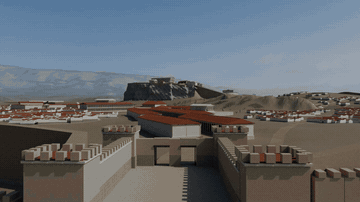

# Athens City Scene · 雅典卫城场景

可编辑的 Blender 古代雅典城市场景，包含卫城地标、院落住宅、道路、地形与植被，以及 **30 秒连续运镜**。



[30 秒视频预览（MP4）](media/athens-30s-preview.mp4) · [静态预览](media/poster.jpg) · [镜头路线](docs/CAMERA.md)

地理位置参考含 **© OpenStreetMap contributors**，按 [ODbL](https://www.openstreetmap.org/copyright) 使用；其他资产见[来源与许可](docs/THIRD_PARTY_ASSETS.md)。

> 预览取自已完成的 720p 成片。公开工程将一张旧地表植被颜色遮罩替换为可复现的程序节点；因此局部地面植被色块可能与预览略有不同。建筑、地形网格、植被实例位置和原始运镜保持不变。

## 快速开始

1. 安装 [Blender](https://www.blender.org/)（本项目使用 **4.3.2** 验证）。
2. 克隆时使用 Git LFS，确保下载到真实二进制文件，而不是指针：
   ```sh
   git lfs install
   git clone https://github.com/Kidand/athens-city-scene.git
   cd athens-city-scene
   git lfs pull
   ```
3. 打开 `scene/athens.blend`，保留同级 `assets/` 目录。按小键盘 `0` 进入相机视图；时间线播放范围为 **1–720 帧，24 fps**。

场景较大，建议至少 8 GB 可用内存。视口播放速度取决于设备；不承诺实时帧率。无需安装任何第三方 Blender 插件。

## 项目内容

| 路径 | 内容 |
|---|---|
| `scene/athens.blend` | 完整可编辑场景，是本项目的权威源文件 |
| `assets/textures/` | 场景实际依赖的纹理与 HDRI，使用相对路径 |
| `camera/` | 原始相机与动画 `.blend`，及全部 720 帧的世界矩阵、焦距与镜头参数 |
| `scripts/` | 场景检查、单帧渲染、相机导入、文件校验和公开版地表节点脚本 |
| `media/` | 从原成片压缩的 GIF、MP4、海报与关键帧总览 |
| `data/geographic-controls.json` | 带来源及 ODbL 说明的地理参考控制数据 |
| `docs/` | 使用说明、镜头信息、第三方来源与复原边界 |

原成片规格：**1280 × 720 · 24 fps · 30.000 秒 · 720 个独立渲染帧 · 无音轨**。GIF 为 360 × 202、4 fps 的完整 30 秒网页预览（约 3.9 MB）；不是新增渲染或补帧。

## 使用与复原边界

- 这是包含不同时期建筑的艺术复原，**不是某一确定年代的考古测绘模型**。
- 房屋、失落雕塑的补全、彩绘、植被和局部地形均含艺术推定。雕塑包含公共领域扫描及项目补全，不将所有雕塑宣称为从零原创。
- `.blend` 保存完整编辑数据；附带脚本用于使用、检查和局部程序化操作，**不承诺从空场景一键重建全部历史制作流程**。
- 本次打包未重渲染完整影片。公开版通过依赖、网格、相机和单帧检查；不等同于所有设备/全部镜头重新渲染验证。

详见 [使用说明](docs/USAGE.md)、[镜头说明](docs/CAMERA.md)、[第三方资产](docs/THIRD_PARTY_ASSETS.md) 与 [许可范围](LICENSE.md)。

---

**English:** An editable Blender artistic reconstruction of Athens, with a preserved 30-second continuous camera tour. The scene combines periods and interpretive details; it is not an archaeological survey. Preview media come from the completed film and predate the public release's small, documented procedural groundcover-color substitution. See the linked documentation for asset credits, camera data and reproduction limits.
